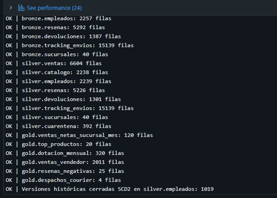
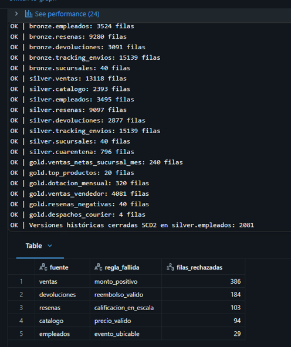
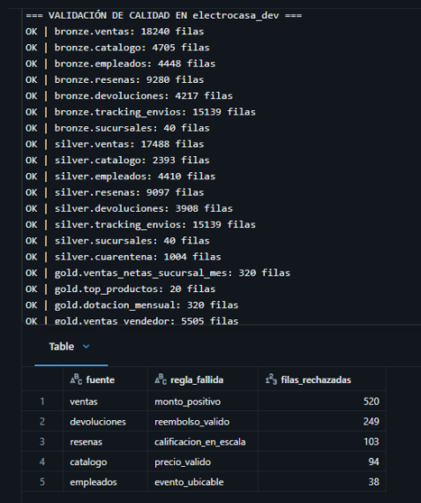
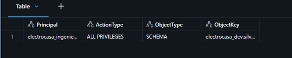
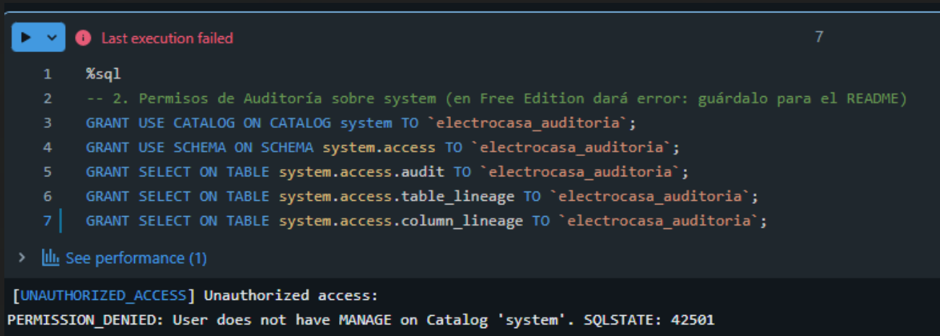

# ElectroCasa Lakehouse

Plataforma de datos sobre Databricks (Unity Catalog) para ElectroCasa, una cadena de 40 sucursales de electrodomésticos en Perú. Integra 6 fuentes y una tabla de referencia en un modelo Medallion (Bronze → Silver → Gold) que responde 6 preguntas de negocio para el período **marzo–octubre 2026**.

**Stack:** Lakeflow Spark Declarative Pipelines · Auto Loader · COPY INTO · Lakeflow Connect · Lakeflow Jobs · Declarative Automation Bundles · Unity Catalog

---

## 1. Arquitectura

```text
 vol_landing (CSV/JSON)                         Azure SQL (dbo.TrackingEnvios)
   │                    │                                │
 COPY INTO          Auto Loader                  Lakeflow Connect (query-based)
 catalogo,          ventas, empleados,           cursor: fecha_modificacion
 sucursales         resenas, devoluciones        PK: evento_id
   │                    │                                │
   └──────────► BRONZE (7 tablas + _ingested_at, _source_file) ◄┘
                          │
                SILVER  limpieza · estandarización · dedup · expectativas
                        SCD2 empleados (AUTO CDC) · MASK dni/salario
                        silver.cuarentena (rechazos consultables)
                          │
                GOLD    6 materialized views (una por pregunta)
                          │
                VALIDACIÓN  conteos + rechazos + falla si Gold vacío
```

### Orden del job `electrocasa_orquestacion`

| # | Tarea | Tipo | Depende de |
|---|---|---|---|
| 1 | `tarea_1_copy_into` | Notebook (COPY INTO) | — |
| 2 | `tarea_2_ingest_tracking` | Pipeline (Lakeflow Connect) | — |
| 3 | `tarea_3_pipeline_medallion` | Pipeline (Bronze/Silver/Gold) | 1 y 2 |
| 4 | `tarea_4_validacion` | Notebook | 3 |

El conector de Tracking y el pipeline principal corren en secuencia, porque Free Edition permite solo una pipeline activa por tipo.

| Configuración | Valor | Por qué |
|---|---|---|
| Trigger | **Llegada de archivo** en `/Volumes/<catalogo>/default/vol_landing/` | Los lotes llegan en fechas irregulares (mayo, agosto, octubre). Un horario fijo correría en vacío casi siempre. |
| Reintentos | 2 en ingesta, 1 en el pipeline, 0 en validación | Las fallas de ingesta suelen ser transitorias (red, SQL). Si la validación falla es porque falta un dato, y reintentar no lo arregla. |
| Alertas | Correo al fallar y al terminar bien (`alert_email`) | Aviso inmediato si un lote no se procesó. |
| Concurrencia | `max_concurrent_runs: 1` | Evita dos corridas de la misma pipeline a la vez (límite de Free Edition). |

> En el target `dev` (`mode: development`) el bundle deja el trigger en pausa, por eso los lotes se corrieron con `bundle run`.

---

## 2. Estructura del repositorio

```text
├── databricks.yml                  # Bundle: targets dev / prod
├── resources/
│   ├── electrocasa_pipeline.yml    # Pipeline Medallion
│   └── electrocasa_job.yml         # Job de 4 tareas
├── src/electrocasa/transformations/
│   ├── 01_bronze.py                # Auto Loader
│   ├── 02_silver.py                # Limpieza, expectativas, SCD2, cuarentena
│   └── 03_gold.py                  # 6 preguntas de negocio
├── notebooks/
│   ├── 00_setup.ipynb              # Catálogo, schemas, volume, máscaras, GRANT/REVOKE
│   ├── 01_copy_into_bronze.ipynb   # COPY INTO idempotente
│   └── 02_validacion.ipynb         # Conteos, rechazos, falla si Gold vacío
└── contratos/                      # 7 contratos de datos (YAML)
```

---

## 3. Despliegue

1. Crear los grupos `electrocasa_ingenieria`, `electrocasa_analistas` y `electrocasa_auditoria` en **Settings > Identity and access > Groups**, y agregarse a `electrocasa_ingenieria`.
2. Ejecutar `notebooks/00_setup.ipynb` con `catalogo = electrocasa_dev` (y luego `electrocasa_prod`).
3. Crear la Connection de Unity Catalog a la Azure SQL (la contraseña se guarda en la Connection, no en el código) y el pipeline de ingesta de Tracking. Poner su ID en `tracking_pipeline_id` de `databricks.yml`.
4. Desplegar y correr el bundle:

```bash
databricks bundle validate -t dev
databricks bundle deploy   -t dev
databricks bundle run electrocasa_orquestacion -t dev
```

5. Subir los archivos de cada lote a `/Volumes/electrocasa_dev/default/vol_landing/<fuente>/` y correr el job. Repetir con los lotes 2 y 3.

| Target | Catálogo | Modo |
|---|---|---|
| `dev` | `electrocasa_dev` | development |
| `prod` | `electrocasa_prod` | production |

**Evidencia de despliegue:** `` ⚠️ agregar captura

---

## 4. Ingesta

| Fuente | Método | Justificación |
|---|---|---|
| Ventas, Devoluciones, Empleados | Auto Loader (Streaming Table) | Llegan por lotes incrementales. Auto Loader procesa solo los archivos nuevos y el pipeline gestiona el checkpoint. |
| Reseñas | Auto Loader (JSON Lines) | Llega por lotes. Se lee con `tags` como `array<string>`, `respuestas` como `array<struct<autor,texto,fecha>>` y `metadata` como texto (en Silver pasa a `VARIANT`). |
| Catálogo | COPY INTO | Llega como snapshots completos y poco frecuentes (2). COPY INTO es idempotente: un archivo ya cargado no se vuelve a cargar. |
| Sucursales | COPY INTO | Es un archivo único de referencia. La carga es idempotente. |
| Tracking | Lakeflow Connect query-based | Obligatorio. Cursor `fecha_modificacion`, PK `evento_id` y solo las columnas necesarias. Destino: `bronze.tracking_envios`. |

- Las fuentes CSV usan un schema explícito (sin `inferSchema`).
- Las columnas de auditoría son `_ingested_at` y `_source_file` (tomada de `_metadata.file_name`).

### Corridas del conector de Tracking

| Corrida | Filas leídas | Resultado |
|---|---|---|
| 1 (carga inicial) | 15 139 | Trae todos los eventos |
| 2 (sin cambios) | 0 | No recarga nada: la ingesta es incremental por el cursor |

`bronze.tracking_envios` se mantiene en **15 139 filas** en las corridas de los lotes 1, 2 y 3: el conector no vuelve a cargar los eventos.

`` · `` ⚠️ agregar capturas

---

## 5. Silver: limpieza y calidad

**Normalizaciones:**

- **Fechas:** pasan a `TIMESTAMP`/`DATE`. Se aceptan los formatos ISO, `dd/MM/yyyy` y `dd/MM/yyyy HH:mm:ss`.
- **Montos:** coma decimal y punto de miles (`1.234,50`), y precios con moneda, pasan a `decimal(12,2)`.
- **Conjuntos cerrados:** categoría, método de pago, canal, tipo de evento de Empleados, estado de entrega y courier.
- **Casing:** `ciudad`, `distrito` y `region` de Sucursales.
- **Deduplicación:** `row_number()` por la llave. Las reingestas no duplican ventas, devoluciones ni reseñas. Los productos repetidos del catálogo quedan una sola vez, con la versión del último snapshot.

### Expectativas y política

| Fuente | Regla | Política | Por qué |
|---|---|---|---|
| Sucursales | `sucursal_id_valido` | **fail** | Es la dimensión base de todas las preguntas. Si falta, nada cuadra. |
| Ventas | `monto_positivo` (monto > 0, cantidad > 0, ids y fecha válidos) | drop | Una venta inválida distorsiona las preguntas 1, 2 y 4. Se descarta y queda en cuarentena. |
| Devoluciones | `reembolso_valido` (0 ≤ reembolso ≤ monto de la venta, venta existente) | drop | Se valida en la vista `vw_devoluciones_enriquecidas`, que hace el join con ventas. |
| Reseñas | `calificacion_en_escala` (1–5) | drop | El enunciado pide excluirlas del numerador y del denominador. |
| Catálogo | `precio_valido` (> 0) | drop | Un precio inválido no sirve como maestro. |
| Empleados | `evento_ubicable` (id y fecha no nulos) | drop | Sin ellos el evento no se puede ubicar en el SCD2. |
| Tracking | `estado_conocido` (pendiente, en_transito, entregado, devuelto) | drop | Un estado desconocido no aporta a la pregunta 6. |

Todos los rechazos van a **`silver.cuarentena`** con `fuente`, `regla_fallida`, `motivo`, `registro_crudo` (JSON), `archivo_lote` y `fecha_procesamiento`.

### SCD Type 2 de Empleados

- Se implementa con `dp.create_auto_cdc_flow(stored_as_scd_type=2)` y `keys=["id_empleado"]`.
- `sequence_by = struct(fecha_evento, fecha_registro)`, tomado de la fuente y no de `current_timestamp()`:
  - `fecha_evento` ordena la historia.
  - `fecha_registro` desempata dos eventos del mismo día.
- Los eventos tardíos que llegan en un lote posterior se ubican en su lugar de la historia.
- Las versiones quedan con `__START_AT` y `__END_AT`. Gold busca la versión vigente a una fecha (preguntas 3 y 4).

### Decisiones propias

| Tema | Decisión |
|---|---|
| Devoluciones con venta inexistente | Se descartan y van a cuarentena (regla `reembolso_valido`). |
| Ventas o reseñas con producto fuera del catálogo | Se conservan en Silver y se excluyen en Gold con un inner join contra el catálogo (preguntas 2 y 5). |
| Tracking con venta inexistente | Se conserva. La pregunta 6 se mide por envío, no por venta. |
| Mensajes reprocesados de Tracking | Se deduplica por `(tracking_id, estado_entrega)` y se conserva el primer registro por `fecha_modificacion`. El reproceso llega con otro `evento_id` y otra `fecha_modificacion`. |
| Mismo `dni` en dos empleados | Se conservan los dos. La llave es `id_empleado`, no el `dni`. |
| Salarios fuera de rango | Un salario > 50 000 se toma como error de escala y se divide entre 100. |
| Productos descontinuados (`activo=false`) | Se conservan marcados. Siguen teniendo ventas y reseñas históricas. |
| Máscara | `dni` → `***`, `salario` → `NULL`, para quien no pertenece a `electrocasa_ingenieria`. |
| Modo del conector | **Append only.** Cada fila es un cambio de estado y la historia completa de cada `tracking_id` se necesita para medir tiempos. Con SCD1 no se pierde nada (la llave es `evento_id`), pero append only refleja mejor que la fuente es un log de eventos. |

---

## 6. Conteos por lote

### Bronze y Silver

| Tabla | Lote 1 | Lote 2 | Lote 3 |
|---|---|---|---|
| `bronze.ventas` | ⚠️ | ⚠️ | 18 240 |
| `bronze.catalogo` | ⚠️ | ⚠️ | 4 705 |
| `bronze.empleados` | 2 257 | 3 524 | 4 448 |
| `bronze.resenas` | 5 292 | 9 280 | 9 280 |
| `bronze.devoluciones` | 1 387 | 3 091 | 4 217 |
| `bronze.sucursales` | 40 | 40 | 40 |
| `bronze.tracking_envios` | 15 139 | 15 139 | 15 139 |
| `silver.ventas` | 6 604 | 13 118 | 17 488 |
| `silver.catalogo` | 2 238 | 2 393 | 2 393 |
| `silver.empleados` (versiones SCD2) | 2 239 | 3 495 | 4 410 |
| ↳ versiones cerradas (`__END_AT` no nulo) | 1 019 | 2 081 | ⚠️ |
| `silver.resenas` | 5 226 | 9 097 | 9 097 |
| `silver.devoluciones` | 1 301 | 2 877 | 3 908 |
| `silver.sucursales` | 40 | 40 | 40 |
| `silver.tracking_envios` | 15 139 | 15 139 | 15 139 |
| `silver.cuarentena` | 392 | 796 | 1 004 |

### Gold

| Tabla | Lote 1 | Lote 2 | Lote 3 |
|---|---|---|---|
| `gold.ventas_netas_sucursal_mes` | 120 | 240 | 320 |
| `gold.top_productos` | 20 | 20 | 20 |
| `gold.dotacion_mensual` | 320 | 320 | 320 |
| `gold.ventas_vendedor` | 2 011 | 4 081 | 5 505 |
| `gold.resenas_negativas` | 25 | 40 | ⚠️ |
| `gold.despachos_courier` | 4 | 4 | ⚠️ |

Evidencia (salida de `tarea_4_validacion`):





**Lectura de los conteos:**

- `gold.ventas_netas_sucursal_mes` crece 120 → 240 → 320 filas (40 sucursales × 3, 6 y 8 meses): cada lote agrega sus meses.
- `silver.catalogo` queda en 2 393 aunque `bronze.catalogo` acumule los dos snapshots: los productos repetidos quedan una sola vez.
- Reseñas no cambia en el lote 3 (9 280 / 9 097) porque solo tiene 2 lotes: no se reprocesan archivos.
- Las versiones cerradas del SCD2 aumentan con cada lote: las transferencias y los eventos tardíos cierran la versión anterior.

### Registros rechazados (`silver.cuarentena`, acumulado)

| Fuente | Regla | Lote 1 | Lote 2 | Lote 3 |
|---|---|---:|---:|---:|
| ventas | `monto_positivo` | 179 | 386 | 520 |
| devoluciones | `reembolso_valido` | 86 | 184 | 249 |
| resenas | `calificacion_en_escala` | 66 | 103 | 103 |
| catalogo | `precio_valido` | 43 | 94 | 94 |
| empleados | `evento_ubicable` | 18 | 29 | 38 |
| tracking_envios | `estado_conocido` | 0 | 0 | 0 |
| **Total** | | **392** | **796** | **1 004** |

Tracking no tiene rechazos: todos sus estados quedaron estandarizados al conjunto cerrado.

---

## 7. Respuestas de negocio (Gold)

| # | Pregunta | Tabla Gold |
|---|---|---|
| 1 | Ventas netas por sucursal y mes | `gold.ventas_netas_sucursal_mes` |
| 2 | Top 10 por unidades y top 10 por tasa de devolución | `gold.top_productos` |
| 3 | Dotación al cierre de cada mes | `gold.dotacion_mensual` |
| 4 | Ventas por vendedor con la sucursal histórica (`SIN_ASIGNAR` si no hay versión vigente) | `gold.ventas_vendedor` |
| 5 | Porcentaje de reseñas negativas por categoría y mes | `gold.resenas_negativas` |
| 6 | Despachos por courier | `gold.despachos_courier` |
| — | Empleados vigentes con máscara (evidencia de masking) | `gold.empleados_vigentes` |
| — | Reto VARIANT: % de reseñas negativas por origen (`metadata:origen`) | `gold.resenas_negativas_origen` |

### Pregunta 6: despachos por courier

| Courier | Horas promedio (pendiente → entregado) | Entregados | Devueltos | Estado final | % devueltos |
|---|---:|---:|---:|---:|---:|
| Olva Courier | ⚠️ | ⚠️ | ⚠️ | ⚠️ | ⚠️ |
| Shalom | 102.43 | 1 399 | 85 | 1 484 | 5.73 |
| Servientrega | 103.83 | 1 363 | 113 | 1 476 | **7.66** |

> ⚠️ Actualizar la tabla después de volver a correr el pipeline. Antes, "Olva" y "Olva Courier" salían como dos couriers distintos y los mensajes reprocesados no se eliminaban (Silver tenía las mismas 15 139 filas que Bronze). Las dos cosas ya están corregidas en `02_silver.py`.

**Lectura:** los tiempos de entrega son parecidos (unas 102–106 h). Servientrega tiene la mayor tasa de devoluciones (7.66 %).

Capturas de las preguntas 1 a 5: `` ⚠️ agregar

---

## 8. Gobierno y seguridad

### Permisos (`00_setup.ipynb`)

| Grupo | Acceso |
|---|---|
| `electrocasa_ingenieria` | `ALL PRIVILEGES` sobre bronze, silver y gold; lectura y escritura en `vol_landing` |
| `electrocasa_analistas` | `USE SCHEMA` + `SELECT` sobre gold |
| `electrocasa_auditoria` | `USE SCHEMA` + `SELECT` sobre gold; lineage en Catalog Explorer |

### Demostración de REVOKE

```sql
USE CATALOG IDENTIFIER(:catalogo);

GRANT  SELECT ON SCHEMA silver TO `electrocasa_analistas`;
SHOW GRANTS ON SCHEMA silver;   -- antes
REVOKE SELECT ON SCHEMA silver FROM `electrocasa_analistas`;
SHOW GRANTS ON SCHEMA silver;   -- después
```

**Antes:** ⚠️ agregar captura (debe aparecer `electrocasa_analistas | SELECT`).

**Después del REVOKE:** solo queda ingeniería; `electrocasa_analistas` ya no tiene acceso a silver.

| Principal | ActionType | ObjectType | ObjectKey |
|---|---|---|---|
| electrocasa_ingenieria | ALL PRIVILEGES | SCHEMA | electrocasa_dev.silver |



### Auditoría (`system.access`)

```sql
GRANT USE CATALOG ON CATALOG system TO `electrocasa_auditoria`;
GRANT USE SCHEMA ON SCHEMA system.access TO `electrocasa_auditoria`;
GRANT SELECT ON TABLE system.access.audit TO `electrocasa_auditoria`;
GRANT SELECT ON TABLE system.access.table_lineage TO `electrocasa_auditoria`;
GRANT SELECT ON TABLE system.access.column_lineage TO `electrocasa_auditoria`;
```

**Error obtenido (Free Edition):**

```text
[UNAUTHORIZED_ACCESS] Unauthorized access:
PERMISSION_DENIED: User does not have MANAGE on Catalog 'system'. SQLSTATE: 42501
```



**Alternativa:** como ni el administrador del workspace tiene `MANAGE` sobre `system`, la evidencia de auditoría es la pestaña **Lineage** de Catalog Explorer. ⚠️ agregar captura `img/lineage.png`

### Masking

- `mask_dni` y `mask_salario` usan `is_account_group_member('electrocasa_ingenieria')`.
- La máscara se declara con `MASK` en el schema de `silver.empleados`, dentro del pipeline.
- El dueño del pipeline es miembro de `electrocasa_ingenieria`, así que las tablas derivadas conservan los valores reales.
- `gold.empleados_vigentes` se deriva de `silver.empleados` y vuelve a declarar `MASK` en su schema. Así ingeniería ve los valores reales, y analistas y auditoría (que tienen `SELECT` sobre gold) ven `***` y `NULL`.

```sql
SELECT id_empleado, dni, salario,
       is_account_group_member('electrocasa_ingenieria') AS soy_ingenieria
FROM electrocasa_dev.gold.empleados_vigentes LIMIT 5;
```

`` ⚠️ agregar captura (debe mostrar `soy_ingenieria = true` y el DNI real)

---

## 9. Monitoreo y compute

```sql
SELECT timestamp, event_type, message
FROM event_log(TABLE(electrocasa_dev.silver.ventas))
WHERE event_type IN ('flow_progress', 'update_progress')
ORDER BY timestamp DESC;
```

`` ⚠️ agregar. Si `system.lakeflow` no está disponible, pegar aquí el error.

| Recurso | Compute | Por qué |
|---|---|---|
| Pipeline Medallion | Serverless | Corre por lote, con datos chicos y sin cluster que mantener. |
| Conector de Tracking | Serverless | Es el único modo que admite Lakeflow Connect. |
| Notebooks (COPY INTO y validación) | Serverless (job compute) | Tareas cortas; no se usan clusters all-purpose. |

---

## 10. Retos extra

- **VARIANT en Reseñas:** `metadata` se guarda como `VARIANT` en `silver.resenas` (con `try_parse_json`). Gold lo usa en `gold.resenas_negativas_origen`, que agrupa por `metadata:origen` (app, web o kiosko).
- **Cuarentena con trazabilidad:** cada rechazo guarda la fuente, la regla, el motivo, el registro crudo, el archivo o lote y la fecha de procesamiento.
